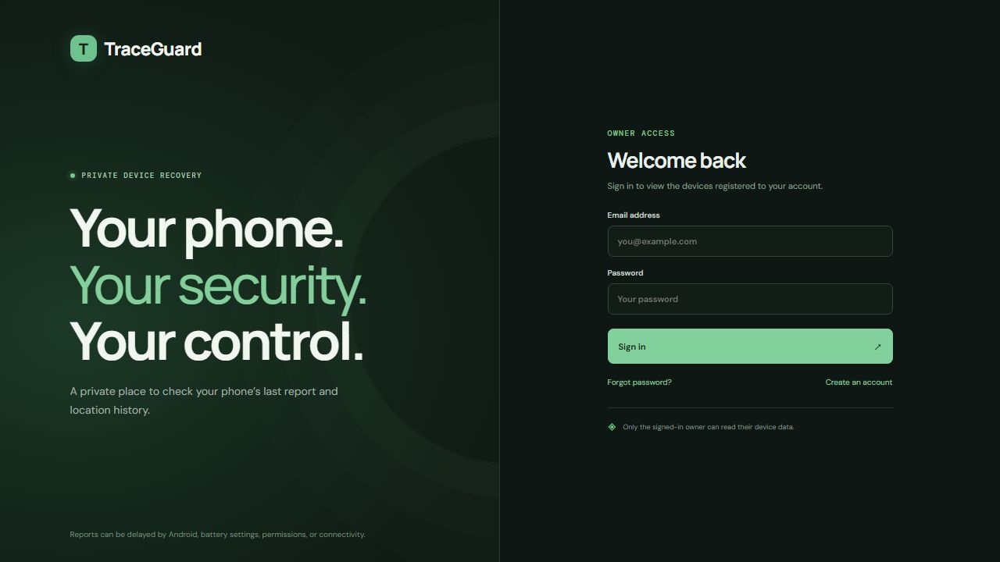

# TraceGuard

An Android device-recovery app with a private web dashboard, built with Kotlin, React, TypeScript and Firebase.

**[Open the live dashboard](https://traceguard-1a8c2.web.app)** · **[Architecture](docs/architecture.md)** · **[Setup and deployment](docs/deployment.md)**



## Features

- Owner account sign-in and device registration
- Latest location, location history and map display
- Battery, connection and report freshness information
- Permission-based periodic reporting and active tracking
- Offline report storage and synchronization
- Optional notification forwarding with Android Notification Access
- Account-scoped Firestore rules and web-session controls

## Technology

| Layer | Stack |
| --- | --- |
| Android | Kotlin, Android SDK, Room, WorkManager, Gradle |
| Dashboard | React, TypeScript, Vite, Leaflet |
| Backend | Firebase Authentication, Cloud Firestore, Firebase Hosting |

## Project layout

```text
android/       Android application and Gradle wrapper
website/       React dashboard and Firestore security rules tests
firebase/      Firestore security rules and indexes
docs/          Architecture, permissions, deployment and screenshots
```

The source is browsable in these folders. `traceguard-source.zip` is the earlier source snapshot; use the folders on the main branch for the current version.

## Development setup

Use Android Studio with a compatible Android SDK and JDK, Node.js and npm for the website, and Firebase CLI with Java 21+ for current Firestore Emulator tooling.

1. Supply your own Android Firebase configuration as `android/app/google-services.json`.
2. Copy `.env.example` to `website/.env.local` and provide your Firebase web app configuration.
3. Build the dashboard:

```powershell
cd website
npm ci
npm run build
```

4. Build the Android debug APK:

```powershell
cd android
.\gradlew.bat :app:assembleDebug
```

Run each command block from the repository root. The APK is written to `android/app/build/outputs/apk/debug/app-debug.apk`.

Environment files, signing keys, APKs, generated builds and personal documents are excluded from source control. Firebase client configuration does not replace database access controls.

## Validation

The project owner reports that the apps have been fully tested. During portfolio preparation on 15 November 2026, the dashboard production build passed. See [validation notes](docs/validation.md) for the scope of independent checks and environment limitations.

## Operating limits

TraceGuard is designed for the owner's own phone with informed consent. Android permissions, battery policies, connectivity and scheduling affect reporting. Active tracking uses Android's foreground-service notification. Force-stop, power-off and revoked permissions can interrupt reports. See [permissions](docs/permissions.md).
