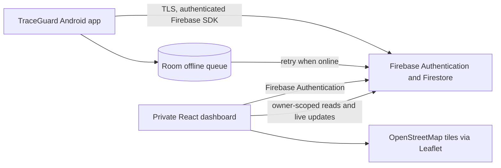

# TraceGuard architecture

## Goal and scope

TraceGuard helps an owner recover their own lost Android phone by showing its last successfully reported location and device status in a private dashboard. Reports are periodically collected, stored locally first, and uploaded when connectivity and Android policy allow. The dashboard labels old reports as stale; Firestore listeners update the page when a new report arrives but do not make the phone continuously transmit.

The design is consent-based. Setup explains the data collected and requests only the permissions needed for selected features. The owner can stop tracking, sign out, revoke the device, and request deletion of stored data. The app remains visible in Android Settings. It does not hide Android privacy indicators or required service notifications and does not bypass force-stop, permission, or battery controls.

## System context



## Components and responsibilities

| Component | Responsibility |
| --- | --- |
| Android setup and account | Explain collection, obtain consent and permissions, authenticate the owner, and register an app-generated device ID. |
| Location and status repositories | Collect location, accuracy, device timestamp, battery/charging, and permitted network details. Return unavailable fields as null with a reason where useful. |
| WorkManager tracking worker | While the owner has opted in, check the owner-controlled cloud tracking state on connected background runs and request best-effort periodic reports only while that state is active. Android controls execution timing and may defer work. |
| Optional location foreground service | Support an owner-started active tracking session with a compliant persistent notification, local queueing while offline, and opt-in restart after reboot. |
| Notification forwarding service | After separate owner consent and Android Notification Access approval, forward notification app name, title, text, and event times to the owner's private Firestore path. |
| Room queue and sync repository | Persist each report before upload, retry with backoff, deduplicate by report ID, and bound offline retention. |
| Firebase Authentication | Identify the owner for website and initial device enrollment. |
| Cloud Firestore | Store per-owner devices, latest status, and location history under owner-scoped paths. Enforce access with Security Rules. |
| React dashboard | Show devices, report freshness, latest location/status, history, settings, and sign-out. |
| Firebase Hosting | Serve the private dashboard's static assets. |

## Data flow

1. The owner signs in and explicitly registers their phone during setup.
2. The dashboard writes `active` or `paused` to the registered device document. The phone's scheduled worker checks that state when online; an active foreground session also listens for pause changes in real time. A scheduled worker checks permissions and location availability before collecting a report.
3. The app creates a report with a unique ID and device-recorded timestamp, then saves it to Room.
4. If authenticated connectivity is available, the app uploads the report. Server receipt time is assigned by Firestore; the device timestamp is retained as a client claim and is not treated as trusted server time.
5. After confirmed upload, the queued record is marked synced or removed according to the local queue policy.
6. The dashboard reads only the signed-in owner's documents and shows both recorded-at and received-at times. It computes freshness from the last report and clearly marks stale data.
7. If the owner separately enables Notification Access, Android forwards text-only notification events to the device's notification subcollection. The dashboard shows the latest 100 and lets the owner clear stored notification history.

## Firestore shape

```text
users/{userId}/devices/{deviceId}
  deviceId, displayName, platform, registeredAt, trackingStatus

users/{userId}/devices/{deviceId}/locations/{locationId}
  locationId, latitude, longitude, accuracyMeters, recordedAt, receivedAt,
  batteryPercentage, charging, connectionType, networkOperator, wifiSsid,
  internetValidated

users/{userId}/devices/{deviceId}/notifications/{notificationId}
  notificationId, appName, packageName, title, body, postedAt, receivedAt
```

`deviceId` is generated by the app and is not an IMEI or other hardware identifier. Wi-Fi SSID and mobile network fields can be unavailable due to Android permission and platform restrictions. Store null instead of inferring their value.

## Security and privacy boundaries

- Require authentication for every dashboard read and device write.
- Scope every device and location read/write to the owning authenticated user ID.
- Do not permit clients to move a device between users or edit ownership fields.
- Validate field types, coordinate ranges, and document shape in Firestore Security Rules. Keep a deny-by-default posture for paths not explicitly needed.
- Use server timestamps for receipt/last-seen fields; preserve client report time separately.
- Never ship service-account credentials or private keys in Android or website bundles.
- Use Android Keystore-backed storage for any locally persisted sensitive credential material.
- Provide revocation and deletion flows and define a configurable retention policy (initial proposal: 30 days).
- Notification forwarding is off by default. It requires separate in-app disclosure and Android's user-controlled Notification Access setting; notification text can contain private messages or verification codes. The owner can pause forwarding and clear stored events from the dashboard.
- Do not create public location links by default.

Initial device enrollment uses the signed-in owner's Firebase identity and writes only within that owner's document path. Rules validate device and report shapes and prevent clients from moving a device between accounts. A trusted ingestion service can be added later if the threat model requires stronger device credentials or server-side validation.

## Reliability and limits

- WorkManager periodic work is best-effort and has a minimum interval; it is not a real-time timer.
- Dashboard pause and resume commands take effect when Android next runs the connected background worker, usually around its 15-minute interval but potentially later. Resume requires the phone to remain signed in, have all-time location permission, and regain internet access. Android may defer or stop background work.
- A location foreground service requires all-time location access, an Android-required notification, and owner opt-in. The app attempts to restart an opted-in live session after boot, but Android or device-specific restrictions can deny or delay it. The app cannot guarantee uninterrupted tracking or hide system indicators.
- Force-stop, power-off, factory reset, permission revocation, disabled location services, lost connectivity, battery restrictions, and device-specific behavior can stop or delay reports.
- Boot recovery is only attempted through documented Android mechanisms and only when allowed by current platform requirements.
- Offline records are bounded and retried with backoff. Duplicate uploads are prevented by stable report IDs.
- The dashboard's real-time listener reflects new server data; it does not imply continuous phone transmission.

## Decisions to revisit before a public release

- Verify the Android permission sequence and foreground-service behavior on supported releases and the target phone.
- Verify report retention, cloud deletion, offline queue clearing, and restore behavior end to end.
- Decide whether a Cloud Function is needed for validated ingestion or scheduled cleanup.
- Confirm website map tile provider terms, attribution, and expected usage.
